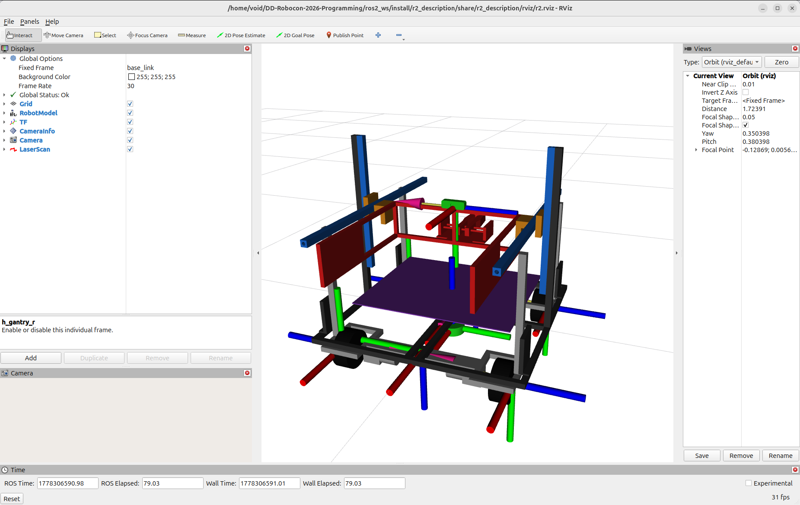
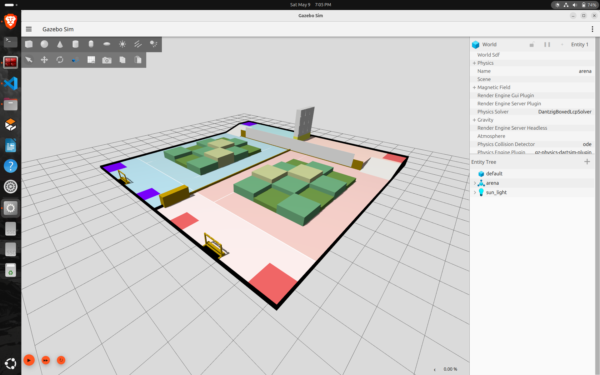

# Stage 2 Programming

1. Currently wokring on Perception, Mapping and Control
2. R2 Simulation

# Team:
1. **Paritosh Raut (Captain)** [paritosh21raut](https://github.com/paritosh21raut)
2. **Sameer Patwardhan** [sam-airobotics](https://github.com/sam-airobotics)
3. **Sahil Kale** [Xtroncs](https://github.com/Xtroncs)
4. **Tejas Raut** [TejasRaut15k](https://github.com/TejasRaut16k)

# System Requirements
- ROS2 Jazzy
- Gazebo Harmonic

Over and out...

### R2

  

### World

  

