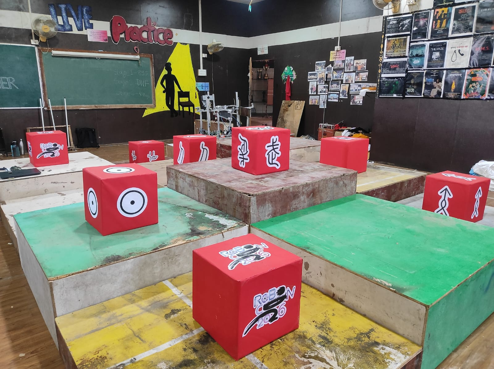

<div align="center">

# 🤖 DD ROBOCON 2026 - Programming

[](https://docs.ros.org/en/jazzy/index.html)
[](https://gazebosim.org/)
[](https://ubuntu.com/)
[](https://www.python.org/)
[](https://github.com/Robocon-Team-CiPHER/DD-Robocon-2026-Programming/actions/workflows/ci.yml)

### **Complete Software Stack for DD ROBOCON 2026**

*ROS 2 Jazzy • Gazebo Harmonic • Computer Vision • SLAM • Navigation • Robot Simulation*

---

*"This repository preserves the software engineering journey of the DD ROBOCON 2026 Programming Team so future teams can continue building upon a strong foundation rather than starting from scratch."*

# 📊 Repository Statistics

| Item | Count |
|------|------:|
| ROS Packages | 4 |
| Arena Components | 10+ |
| Vision Datasets | 2 |
| Detection Models | YOLO + OpenCV |
| Simulation Worlds | 1 |
| Programming Languages | Python |
| CI Workflows | 1 |

</div>

---

# 📖 Overview

This repository contains the complete software stack developed for the **R2 Robot** during **DD ROBOCON 2026**.

The project was developed to simulate, visualize and prepare the competition robot using **ROS 2 Jazzy** and **Gazebo Harmonic**, while simultaneously developing perception, mapping, navigation and robot control for the physical platform.

Unlike a conventional code repository, this project is intended to serve as a **technical handover document** for future programming teams. Along with the source code, it documents the engineering decisions, development workflow, challenges encountered, learning resources, and lessons learned throughout the season.

The repository includes:

- 🤖 Complete Robot Simulation
- 🌍 Competition Arena Simulation
- 👁️ Computer Vision Pipeline
- 🗺️ SLAM & Navigation
- ⚙️ Robot Control
- 📦 Robot Description Package
- 📸 Development History
- 🎥 Vision Demonstrations
- 📚 Learning Resources
- 🔄 Continuous Integration

# 📑 Table of Contents

- [Overview](#-overview)
- [Objectives](#-objectives)
- [Programming Team](#-programming-team)
- [Software Stack](#-software-stack)
- [Repository Structure](#-repository-structure)
- [Development Timeline](#-development-timeline)
- [Development Journey](#-development-journey)
  - [Arena Development](#️-phase-1--arena-development)
  - [Robot Description](#-phase-2--robot-description-development)
  - [Parallel Development](#️-phase-3--parallel-development)
- [ROS Packages](#-ros-2-packages)
- [Build Instructions](#️-building-the-project)
- [Continuous Integration](#-continuous-integration)
- [Project Status](#-current-project-status)
- [Known Issues](#-known-issues)
- [Learning Resources](#-learning-resources)
- [FusionToDescription](#-fusiontodescription)
- [Recommendations](#-recommendations-for-the-next-programming-team)
- [Contributors](#-contributors)

---

# 🎯 Objectives

The primary goals of this repository are to:

- Develop a complete ROS 2 software stack for the DD ROBOCON 2026 R2 robot.
- Build a reusable simulation environment before hardware integration.
- Develop a perception pipeline for Kung Fu Scroll detection.
- Experiment with SLAM and autonomous navigation.
- Document the complete development process for future programming teams.
- Preserve engineering knowledge beyond a single ROBOCON season.

---

# 🚀 Current Development

The project currently focuses on the following major subsystems:

| Module | Description |
|----------|-------------|
| 🤖 Robot Description | URDF, meshes, TF tree and simulation assets |
| 🌍 Arena Simulation | Gazebo world and modular arena components |
| ⚙️ Robot Control | ros2_control and mechanism controllers |
| 👁️ Computer Vision | Kung Fu Scroll detection using OpenCV & YOLO |
| 🗺️ Mapping | SLAM experimentation and map generation |
| 🧭 Navigation | Autonomous navigation research |
| 🔌 Embedded Systems | ESP32-based mecanum feedback |

---

# 👥 Programming Team

| Member | Role | GitHub |
|---------|------|---------|
| **Paritosh Raut** | Captain | [@paritosh21raut](https://github.com/paritosh21raut) |
| **Sameer Patwardhan** | Programming Team | [@sam-airobotics](https://github.com/sam-airobotics) |
| **Sahil Kale** | Programming Team | [@Xtroncs](https://github.com/Xtroncs) |
| **Tejas Raut** | Programming Team | [@TejasRaut15k](https://github.com/TejasRaut15k) |

---

# 🖥️ Software Stack

| Component | Version |
|------------|----------|
| Operating System | Ubuntu 24.04 LTS |
| Robotics Middleware | ROS 2 Jazzy |
| Simulator | Gazebo Harmonic |
| Computer Vision | OpenCV |
| Deep Learning | Ultralytics YOLO |
| Programming Language | Python 3 |
| CAD Software | Autodesk Fusion 360 |

---

# 📂 Repository Structure

```text
DD-Robocon-2026-Programming
│
├── .github/
│   └── workflows/
│       └── ci.yml
│
├── ros2_ws/
│   └── src/
│       ├── r2_description/
│       ├── r2_control/
│       ├── r2_perception/
│       └── r2_slam/
│
├── arena_components/
│
├── r2/
│
├── vision/
│   ├── OpenCV/
│   └── Media/
│
├── highlights/
│   ├── arena/
│   ├── rviz/
│   └── stage_1/
│
├── .gitignore
└── README.md
```

---

# 📦 Repository Components

| Directory | Purpose |
|------------|---------|
| `ros2_ws/src/` | Complete ROS 2 workspace containing all software packages |
| `r2/` | CAD meshes exported from Fusion 360 |
| `arena_components/` | Individual SDF models used to construct the competition arena |
| `vision/OpenCV/` | Datasets, detection scripts, YOLO models and computer vision experiments |
| `vision/Media/` | Videos, screenshots and perception demonstrations |
| `highlights/` | Development screenshots documenting the team's progress |
| `.github/workflows/` | GitHub Actions Continuous Integration workflow |

---

# 🗓️ Development Timeline

The software stack evolved incrementally throughout the season.

| Phase | Description | Lead | Status |
|--------|-------------|------|:------:|
| 1 | Arena CAD Design | Programming Team | ✅ |
| 2 | STL Export | Programming Team | ✅ |
| 3 | SDF Generation | Programming Team | ✅ |
| 4 | Gazebo Arena Simulation | [@sam-airobotics](https://github.com/sam-airobotics) | ✅ |
| 5 | Fusion2URDF Robot Export | [@sam-airobotics](https://github.com/sam-airobotics) | ⚠️ |
| 6 | ACDC4Robot Export | [@sam-airobotics](https://github.com/sam-airobotics) | ✅ |
| 7 | Manual `r2_description` Development | [@sam-airobotics](https://github.com/sam-airobotics) | ✅ |
| 8 | Computer Vision Pipeline | [@Xtroncs](https://github.com/Xtroncs) | ✅ |
| 9 | SLAM & Navigation | [@Xtroncs](https://github.com/Xtroncs) | 🟡 |
| 10 | ESP32 Mecanum Feedback | [@TejasRaut15k](https://github.com/TejasRaut15k) | 🟡 |
| 11 | Full Software Integration | Programming Team | 🚧 |

---

# 📈 Project Status

| Module | Status |
|----------|:------:|
| Arena Components | ✅ |
| Gazebo Arena | ✅ |
| Robot Description | ✅ |
| RViz Visualization | ✅ |
| Computer Vision | ✅ |
| Robot Control | 🟡 |
| SLAM | 🟡 |
| Navigation | 🟡 |
| Hardware Integration | ⏳ |
| Competition Ready | 🚧 |

---

# 🚀 Development Journey

The DD ROBOCON 2026 software stack was not built all at once. It evolved through multiple development phases as different subsystems were designed, tested, integrated and improved throughout the season.

The journey documented below represents the engineering process followed by the Programming Team and serves as a guide for future members.

---

# 🏟️ Phase 1 — Arena Development

The arena was the very first subsystem to be completed.

Instead of designing one large Gazebo world directly, every arena object was modelled independently in **Autodesk Fusion 360**.

This modular approach made every object reusable, easier to modify and significantly simplified testing.

## Development Workflow

```text
Fusion 360 CAD
        │
        ▼
Export STL Models
        │
        ▼
Generate SDF Models
        │
        ▼
Validate Individual Models
        │
        ▼
Assemble Complete Arena
        │
        ▼
Generate arena.world
        │
        ▼
Launch in Gazebo Harmonic
```

---

## Arena Components

The following reusable arena models are available inside

```text
arena_components/
```

- Fake Kung Fu Scroll
- R1 Kung Fu Scroll
- R2 Kung Fu Scroll Variants
- Hand
- Fist
- Spear
- Staff

Each model contains

```text
model.sdf
model.config
meshes/
materials/
```

allowing the arena to be rebuilt or modified without redesigning every object.

---

## Arena Evolution

Throughout development the arena was continuously improved.

Improvements included

- Better object placement
- Correct scaling
- Lighting
- Gazebo compatibility
- World optimization

Progress screenshots are available in

```text
highlights/arena/
```

### Final Arena

<p align="center">

</p>

---

# 🤖 Phase 2 — Robot Description Development

With the arena simulation complete, attention shifted towards creating a digital twin of the **R2 Robot**.

The goal was to generate a ROS-compatible robot description package that could be visualized in RViz and simulated in Gazebo.

---

## Initial Workflow — Fusion2URDF

The initial workflow used the open-source **Fusion2URDF** exporter developed by **[@syuntoku14](https://github.com/syuntoku14)**.

Repository:

https://github.com/syuntoku14/fusion2urdf

Before exporting, the robot CAD model was designed following the recommended Fusion 360 practices described in the following tutorial.

**Reference used by:** [@sam-airobotics](https://github.com/sam-airobotics)

📺 https://www.youtube.com/live/o7w7yv-Nros?si=TL13eZsqMi0NQmiZ

The tutorial covered

- Assembly organization
- Component hierarchy
- Joint placement
- Base Link
- Naming conventions
- Fusion2URDF compatible CAD design

---

## Challenges Encountered

Although Fusion2URDF successfully generated an initial package, the exported robot could not be used directly.

Several problems were encountered during simulation.

### Issues

- Incorrect joint hierarchy
- Mesh alignment problems
- Invalid URDF
- Package structure issues
- Launch failures
- Gazebo incompatibilities
- Missing configuration
- Difficult debugging

After numerous debugging attempts it became clear that manually rebuilding the package would be a more reliable solution.

---

## ACDC4Robot Workflow

A second export workflow was then adopted using the **ACDC4Robot** Fusion 360 Add-In.

Repository

https://github.com/bionicdl-sustech/ACDC4Robot

Unlike the previous workflow, ACDC4Robot produced significantly cleaner exports.

The add-in was used primarily to obtain

- Robot Meshes
- URDF
- Link Structure

These exported assets became the starting point for manually rebuilding the robot description package.

---

## Manual Creation of r2_description

Using the meshes and URDF exported by ACDC4Robot,

**[@sam-airobotics](https://github.com/sam-airobotics)** manually developed the complete **`r2_description`** package.

This process included rebuilding nearly every part of the package.

### Work Completed

- ROS 2 package creation
- URDF restructuring
- Mesh organization
- TF hierarchy
- Gazebo launch files
- RViz configuration
- Material configuration
- Package dependencies
- Simulation debugging
- Controller preparation

The resulting package became the foundation of the complete simulation stack.

---

# Robot Visualization

Once the description package was completed, the robot could successfully be visualized in RViz.

<p align="center">

</p>

Additional screenshots documenting the debugging process are available inside

```text
highlights/rviz/
```

These screenshots show

- URDF debugging
- TF validation
- Robot visualization
- Controller testing
- Continuous improvements throughout development

---

# 🌍 Gazebo Integration

After successfully creating the robot description package, the next objective was integrating the robot into the simulated arena.

The complete simulation consisted of

```text
Arena World
        +
Arena Components
        +
Robot Description
        +
Gazebo Physics
        +
Controllers
```

This enabled complete software testing without requiring the physical robot.

---

## Simulation Goals

The simulation was intended to provide

- Robot visualization
- Mechanism validation
- Arena testing
- Controller development
- Future SLAM testing
- Navigation experiments
- Perception testing

before deployment onto real hardware.

---

# 📸 Simulation Progress

Throughout the season the simulation improved gradually.

The repository contains screenshots documenting this evolution.

```
highlights/
├── arena/
├── rviz/
└── stage_1/
```

Examples include

- Initial robot visualization
- Arena integration
- RViz configuration
- Gazebo testing
- Robot placement
- Controller debugging

These development snapshots preserve the team's engineering progress for future programming teams.

---

# 💡 Lessons Learned

Creating a reliable robot description package required considerably more effort than anticipated.

The team's key observations include:

- Proper CAD organization greatly simplifies URDF generation.
- Automated exporters are useful starting points but often require manual refinement for complex robots.
- Separating meshes, URDF, and launch files improves maintainability.
- RViz should be used to validate TF frames and robot structure before moving to Gazebo.
- Modular package organization makes debugging significantly easier.
- Early investment in a robust simulation environment saves time during hardware integration.

---

# ⚙️ Phase 3 — Parallel Development

Once the **`r2_description`** package became operational, development branched into multiple parallel workstreams. Each team member focused on a dedicated subsystem while maintaining compatibility with the overall ROS 2 architecture.

This parallel development significantly accelerated progress and enabled multiple features to mature simultaneously.

---

# 🤖 Robot Simulation & ROS Infrastructure

**Lead:** [@sam-airobotics](https://github.com/sam-airobotics)

With the robot successfully visualized in RViz and Gazebo, the next objective was creating a reusable ROS 2 simulation environment.

### Responsibilities

- Manual creation of `r2_description`
- Gazebo simulation
- Arena integration
- Robot visualization
- ROS 2 package architecture
- ros2_control preparation
- TF validation
- Launch file organization
- Package dependency management
- Simulation debugging

### ROS Packages

```text
ros2_ws/src/r2_description/
ros2_ws/src/r2_control/
```

---

# 👁️ Computer Vision

**Lead:** [@Xtroncs](https://github.com/Xtroncs)

Computer Vision development focused on detecting and recognizing the **Kung Fu Scrolls (KFS)** used throughout the competition arena.

The vision pipeline was developed independently of the simulation, allowing continuous experimentation while the robot simulation matured.

---

## Vision Development Workflow

```text
Arena Images
      │
      ▼
Dataset Collection
      │
      ▼
Dataset Cleaning
      │
      ▼
OpenCV Experiments
      │
      ▼
YOLO Training
      │
      ▼
Detection Testing
      │
      ▼
ROS Integration
```

---

## Vision Repository Structure

```text
vision/
│
├── OpenCV/
│   ├── KFS_Detection/
│   ├── yolov8/
│   ├── yolokfs/
│   ├── datasets/
│   └── detection scripts
│
└── Media/
    ├── Images
    ├── Videos
    └── Detection Demonstrations
```

---

## Vision Experiments

The repository contains

- Image datasets
- Clean datasets
- Detection scripts
- YOLO experiments
- Training models
- Inference utilities
- Documentation
- Detection demonstrations

---

## Kung Fu Scroll Recognition

The perception system was developed to recognize

- Real Kung Fu Scrolls
- Fake Kung Fu Scrolls
- Arena Symbols
- Mission Targets

Reference images

<p align="center">


</p>

Competition arena reference

<p align="center">



</p>

---

## Detection Demonstrations

The repository includes multiple detection demonstrations.

```
vision/Media/demo_video.webm

vision/Media/kfs_detect_video.mp4
```

These recordings document the evolution of the perception pipeline.

---

# 🗺️ SLAM & Navigation

**Lead:** [@Xtroncs](https://github.com/Xtroncs)

Alongside computer vision development, work also began on robot localization, mapping and autonomous navigation.

The objective was to prepare the software stack for autonomous operation once hardware became available.

Current research includes

- Mapping
- Localization
- SLAM
- Navigation
- Sensor Fusion

ROS Package

```text
ros2_ws/src/r2_slam/
```

---

## Learning Resource

Simulation, SLAM and Navigation development was heavily inspired by the outstanding tutorials created by **Articulated Robotics**.

**Reference used by:** [@Xtroncs](https://github.com/Xtroncs)

📺 https://www.youtube.com/@ArticulatedRobotics

The tutorials served as references for

- ROS 2 Fundamentals
- Gazebo Harmonic
- URDF
- TF2
- Robot Simulation
- ros2_control
- SLAM Toolbox
- Navigation2
- Localization

Future programming teams are strongly encouraged to study this channel before extending the simulation stack.

---

# 🔌 Embedded Systems

**Lead:** [@TejasRaut15k](https://github.com/TejasRaut15k)

Robot hardware development continued alongside software development.

The primary objective was to develop the embedded software required to interface with the physical mecanum robot.

Responsibilities included

- ESP32 Development
- Encoder Feedback
- Mecanum Wheel Feedback
- Motor Interface
- Hardware-side Motion Control

The hardware interface is intended to integrate with the ROS 2 control stack once the complete robot becomes available.

---

# 🏗️ System Integration

The long-term architecture of the software stack is illustrated below.

```text
                    Camera
                       │
                       ▼
                r2_perception
                       │
                       ▼
              Object Detection
                       │
                       ▼
                Mission Logic
                       │
         ┌─────────────┴─────────────┐
         ▼                           ▼
   Navigation                  Robot Control
         │                           │
         ▼                           ▼
      r2_slam                  r2_control
         │                           │
         └─────────────┬─────────────┘
                       ▼
               Physical Robot
                       ▲
                       │
                r2_description
                       │
                       ▼
              Gazebo Harmonic
```

---

# 📦 ROS 2 Packages

The ROS workspace is organized into modular packages.

| Package | Purpose |
|----------|----------|
| **r2_description** | Robot description, URDF, meshes, Gazebo and RViz configuration |
| **r2_control** | ros2_control controllers and robot mechanisms |
| **r2_perception** | Camera interface and perception pipeline |
| **r2_slam** | Mapping, localization and SLAM |

Workspace

```text
ros2_ws/src/
```

---

# 📊 Development Progress

By the end of the season the following milestones had been achieved.

| Feature | Status |
|----------|:------:|
| Arena Models | ✅ |
| Gazebo Arena | ✅ |
| Robot Description | ✅ |
| RViz Visualization | ✅ |
| Computer Vision Pipeline | ✅ |
| Dataset Preparation | ✅ |
| YOLO Training | ✅ |
| Detection Testing | ✅ |
| SLAM Experiments | 🟡 |
| Navigation Research | 🟡 |
| ros2_control | 🟡 |
| Embedded Feedback | 🟡 |
| Full Robot Integration | 🚧 |

---

# 🏁 End-of-Season Status

By the conclusion of the DD ROBOCON 2026 season:

✅ The arena simulation was operational.

✅ The robot could be visualized in RViz and Gazebo.

✅ Computer vision models successfully detected Kung Fu Scrolls.

✅ The software architecture had been modularized into dedicated ROS 2 packages.

However, complete integration could not be finalized before the season concluded.

Near the end of development, the **mechanical design of the R2 robot was revised**.

As a result, the simulation contained in this repository represents an earlier revision of the robot.

The updated CAD was not available in time to regenerate the robot description package.

Future programming teams should therefore treat this repository as a **software foundation**, update the robot description using the latest mechanical design, and continue development from there instead of rebuilding the infrastructure from scratch.

---

# 🛠️ Building the Project

## System Requirements

| Component | Version |
|-----------|----------|
| Operating System | Ubuntu 24.04 LTS |
| ROS 2 | Jazzy Jalisco |
| Gazebo | Harmonic |
| Python | 3.x |
| OpenCV | Latest |
| Colcon | Latest |

---

## Clone Repository

```bash
mkdir -p ~/ros2_ws/src

cd ~/ros2_ws/src

git clone https://github.com/Robocon-Team-CiPHER/DD-Robocon-2026-Programming.git

cd ..
```

---

## Install Dependencies

```bash
sudo apt update

rosdep install --from-paths src --ignore-src -r -y
```

---

## Build Workspace

```bash
colcon build --symlink-install
```

---

## Source Workspace

```bash
source install/setup.bash
```

It is recommended to add this command to your `.bashrc`.

```bash
echo "source ~/ros2_ws/install/setup.bash" >> ~/.bashrc
```

---

# ▶️ Running the Simulation

Launch the robot description.

```bash
ros2 launch r2_description display.launch.py
```

Launch Gazebo.

```bash
ros2 launch r2_description gazebo.launch.py
```

Launch Controllers.

```bash
ros2 launch r2_control controllers.launch.py
```

Launch SLAM.

```bash
ros2 launch r2_slam online_async_launch.py
```

Launch Perception.

```bash
ros2 run r2_perception vision_node
```

---

# 🔄 Continuous Integration

This repository uses **GitHub Actions** to automatically validate every contribution.

The workflow is located in

```text
.github/workflows/ci.yml
```

Every **Pull Request** and every **push to the `main` branch** automatically executes:

- ROS package validation
- Dependency resolution
- `colcon build`
- `colcon test`

This helps ensure that new contributions do not introduce build failures into the repository.

---

# 📁 Repository Standards

To keep the repository clean and maintainable, generated files are excluded using `.gitignore`.

Ignored files include:

```text
build/
install/
log/
.vscode/
__pycache__/
*.pyc
*.pyo
*.swp
```

Only source code, documentation, CAD assets, datasets, and required project files are committed.

---

# 📊 Current Project Status

| Module | Status |
|----------|:------:|
| Arena Components | ✅ Complete |
| Gazebo Arena | ✅ Complete |
| Robot Description | ✅ Complete |
| RViz | ✅ Complete |
| Robot Simulation | 🟡 Functional |
| ros2_control | 🟡 In Progress |
| Computer Vision | ✅ Working |
| YOLO Detection | ✅ Working |
| Dataset Creation | ✅ Complete |
| Mapping | 🟡 In Progress |
| Navigation | 🟡 In Progress |
| Embedded Feedback | 🟡 In Progress |
| Hardware Integration | ⏳ Pending |
| Competition Ready | 🚧 Not Yet |

---

# ⚠️ Important Notice

Near the end of the DD ROBOCON 2026 season, the **mechanical design of the R2 robot underwent significant revisions**.

Unfortunately, these changes occurred after most of the software infrastructure had already been developed.

As a result, the robot description package contained in this repository represents an **earlier revision** of the robot.

The updated CAD was not available in time to regenerate the simulation before the competition.

Therefore, **the first task for the next programming team should be updating the robot description to match the latest mechanical design.**

---

## Components That Need Updating

The following components should be regenerated using the latest Fusion 360 assembly:

- Robot meshes
- URDF/Xacro
- Collision geometry
- Inertia values
- Joint hierarchy
- Joint limits
- TF frames
- Wheel positions
- Sensor mounting locations
- ros2_control configuration
- Gazebo physics parameters

Once these updates are completed, the remainder of the software stack can continue to evolve without requiring major architectural changes.

---

# 🚧 Known Issues

Although the repository provides a strong software foundation, several issues remain.

---

## Robot Collision Model

Current collision meshes are not perfectly aligned with the robot geometry.

This may result in:

- Incorrect contact behaviour
- Objects intersecting the robot
- Unrealistic physics

---

## Gazebo Physics

Further tuning is required for:

- Inertia
- Friction
- Contact properties
- Wheel dynamics

---

## Robot Dynamics

The robot motion has not yet been fully validated against the physical platform.

Parameters requiring verification include:

- Wheel radius
- Wheel separation
- Center of gravity
- Robot mass
- Controller gains

---

## Perception Integration

Computer Vision development successfully detects Kung Fu Scrolls.

The next step is integrating the perception pipeline with:

- Mission Logic
- Navigation
- Robot Behaviour
- Autonomous Decision Making

---

# 🚀 Check Out

The following projects were either used during development or created to simplify future robotics workflows.

---

## 🛠️ FusionToDescription

**Developed by:** [@sam-airobotics](https://github.com/sam-airobotics)

🔗 https://github.com/sam-airobotics/FusionToDescription

FusionToDescription is an Autodesk Fusion 360 Add-In developed after the challenges encountered while creating the `r2_description` package for this project.

It automates much of the process required to generate ROS robot description packages directly from Fusion 360.

### Features

- ROS 2 Package Generation
- URDF/Xacro Generation
- Robot Description Package
- Material Export
- ros2_control Configuration
- Gazebo Launch Files
- RViz Configuration
- Mesh Export
- Organized Package Structure

Future programming teams are encouraged to evaluate this add-in when creating robot description packages for future ROBOCON robots.

---

## 🔧 Fusion2URDF

Developer:

[@syuntoku14](https://github.com/syuntoku14)

https://github.com/syuntoku14/fusion2urdf

The original Fusion 360 → URDF exporter used during the early stages of this project.

---

## 🔧 ACDC4Robot

Repository

https://github.com/bionicdl-sustech/ACDC4Robot

Fusion 360 Add-In capable of exporting robot descriptions to

- URDF
- SDFormat
- MJCF

The exported meshes and URDF formed the basis of the manually reconstructed `r2_description` package.

---

# 📚 Learning Resources

Throughout the season, the Programming Team relied on several outstanding open-source projects and educational resources.

| Resource | Referred by | Purpose |
|----------|-------------|---------|
| 📺 [Fusion 360 → URDF Design Tutorial](https://www.youtube.com/live/o7w7yv-Nros?si=TL13eZsqMi0NQmiZ) | [@sam-airobotics](https://github.com/sam-airobotics) | Designing Fusion 360 assemblies for Fusion2URDF |
| 📺 [3Blue1Brown](https://www.youtube.com/@3blue1brown) | [@sam-airobotics](https://github.com/sam-airobotics) | Mathematics, Linear Algebra, Calculus, Probability, Optimization and Robotics Fundamentals |
| 📺 [Articulated Robotics](https://www.youtube.com/@ArticulatedRobotics) | [@Xtroncs](https://github.com/Xtroncs) | ROS 2, Gazebo Harmonic, SLAM, Navigation2 and Robot Simulation |
| 💻 [Fusion2URDF](https://github.com/syuntoku14/fusion2urdf) | Programming Team | Initial Fusion 360 → URDF exporter |
| 💻 [ACDC4Robot](https://github.com/bionicdl-sustech/ACDC4Robot) | [@sam-airobotics](https://github.com/sam-airobotics) | Fusion 360 exporter for URDF, SDF and MJCF |
| 📖 ROS 2 Documentation | Programming Team | ROS 2 APIs and Middleware |
| 📖 Gazebo Documentation | Programming Team | Robot Simulation and World Development |

---

# 🎯 Recommendations for the Next Programming Team

Before the next DD ROBOCON theme is announced, we strongly recommend completing the following tasks.

## High Priority

- ✅ Update the `r2_description` package using the latest R2 CAD model.
- ✅ Regenerate robot meshes.
- ✅ Rebuild collision geometry.
- ✅ Update URDF and TF hierarchy.
- ✅ Retune Gazebo physics.
- ✅ Validate robot dynamics with the physical platform.

---

## Medium Priority

- Complete perception integration.
- Improve SLAM.
- Complete Navigation.
- Tune ros2_control.
- Integrate hardware feedback.
- Add package-level documentation.

---

## Long-Term Improvements

- Navigation2 integration
- Behavior Trees
- Lifecycle Nodes
- Docker Development Environment
- Hardware Bringup Package
- Automated Robot Diagnostics
- Unit Testing
- Performance Benchmarking
- Complete Digital Twin

---

# 🙌 Contributors

| Contributor | Contributions |
|-------------|---------------|
| [@sam-airobotics](https://github.com/sam-airobotics) | Robot simulation, manual `r2_description` package creation, Gazebo integration, ROS infrastructure, RViz configuration, software architecture, FusionToDescription |
| [@Xtroncs](https://github.com/Xtroncs) | Computer Vision, OpenCV, YOLO, Kung Fu Scroll detection, SLAM, Mapping, Navigation |
| [@TejasRaut15k](https://github.com/TejasRaut15k) | ESP32 firmware, mecanum feedback, embedded systems, hardware communication |
| [@paritosh21raut](https://github.com/paritosh21raut) | Team leadership, project planning, system integration and competition coordination |

---

# 🙏 Acknowledgements

This repository represents the collective effort of the **DD ROBOCON 2026 Programming Team**.

It documents not only the software that was developed, but also the engineering decisions, experiments, challenges, and lessons learned throughout the season.

Every simulation, every failed launch, every debugging session, and every successful build contributed to the knowledge preserved here.

We hope future teams will continue improving this work rather than rebuilding it.

---

<div align="center">

# 🚀 To the Next Programming Team

Every ROBOCON season introduces a new challenge, but a strong software foundation should not have to be rebuilt each year.

This repository is our contribution to that foundation.

Learn from our successes.

Learn from our mistakes.

Question every design decision.

Improve every subsystem.

Document your work.

And leave the repository in a better state than you found it.

**Good Luck. Build Something Better. 🤖**

---

**Developed with ❤️ by the DD ROBOCON 2026 Programming Team**

**Organization:** https://github.com/Robocon-Team-CiPHER

</div>
