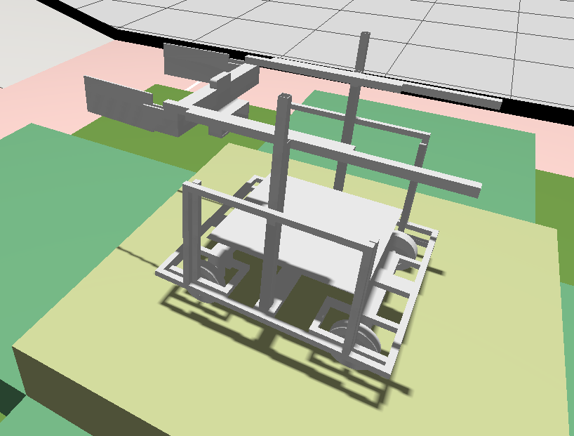

# Gazebo-Simulation-R2
Simulation of R2 Robocon -v2

1. Added the URDF File into the world.
2. Added the arena_components
3. Just need to change the inertia of the components.
4. Can use 'Translate' in gz sim to move the r2 in environment...
5. Needs further changes to it...

Over and out...

  

  

